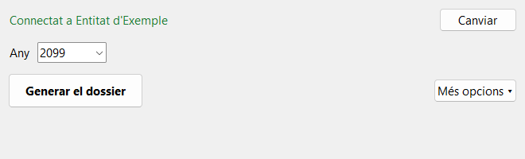

# Dossier de factures

[Versió en català](README.md)

Programa para Windows que genera, desde Odoo, el registro anual de facturas de proveedor (Excel) y un dossier PDF con todas las facturas. Está pensado para asociaciones que deben justificar una subvención, y para personas que lo usarán una vez al año.

**El programa solo lee de Odoo: no puede crear, cambiar ni borrar ningún dato.**

La interfaz está en catalán; la versión en castellano se puede añadir con un fichero de traducción.



## Qué genera

Cada vez crea una carpeta nueva con:

- **Un Excel** con todas las facturas y recibos del año: número, proveedor, NIF, base, IVA, total, pagos, trimestre y página del dossier. También salen los demás gastos del año (nóminas, comisiones del banco…), en un apartado aparte, porque no tienen documento.
- **Un PDF** con portada, índice con enlaces y cada factura en una hoja A4, con una cabecera que resume los datos de la factura y el pago. Las imágenes se comprimen para que el fichero sea manejable.

Si falta algo, por ejemplo un documento o un NIF, el programa lo dice al final en una lista de avisos.

## Qué hace falta

- **Windows 10 u 11** de 64 bits.
- **Odoo 19**, con acceso a su API externa. En Odoo Online esto **necesita el plan Custom**: con los demás planes Odoo rechaza la conexión, y el programa lo explica con un mensaje.
- **Un usuario de Odoo con permiso para leer la contabilidad**, y una clave de API de ese usuario.

> De momento el programa solo se ha probado con la clave de un usuario administrador. El permiso mínimo, "Contabilidad / Solo lectura", todavía no se ha comprobado. Recomendamos usar un usuario de solo lectura. Si su permiso no es suficiente, el programa lo dirá con un mensaje.

## Cómo crear la clave de API

1. En Odoo, haz clic en tu nombre (arriba a la derecha) y abre las preferencias.
2. En la pestaña **Seguridad**, haz clic en **Add API Key**.
3. Escribe una descripción, por ejemplo `Dossier de factures`, y elige la duración. Odoo puede pedirte la contraseña.
4. Copia la clave que aparece. **Odoo solo la muestra esta vez.**

**Duración:** como el programa se usa una vez al año, elige **1 Year** si Odoo lo permite. Cada grupo de usuarios tiene un límite (campo *API Keys maximum duration days* del grupo): el rol de miembro puede estar limitado a 90 días, y entonces habrá que crear una clave nueva cada año, o que un administrador aumente el límite. Cuando una clave caduca, el programa lo dice y pide la nueva.

Los nombres de los botones dependen del idioma de Odoo, y algunos salen en inglés.

## Cómo instalarlo

No hay que instalar nada.

1. Ve a [Releases](https://github.com/clamarobcn/odoo-dossier-factures/releases) y descarga **DossierFactures.exe**.
2. Guárdalo donde quieras, por ejemplo en el Escritorio, y ábrelo con un doble clic. La primera vez puede tardar unos segundos.

### El aviso de Windows

El programa no está firmado digitalmente, porque la firma tiene un coste anual. Por eso Windows puede mostrar un aviso de **SmartScreen**. Según el idioma de Windows, para continuar:

| Windows en catalán | Windows en castellano |
|---|---|
| **Més informació** | **Más información** |
| **Executa igualment** | **Ejecutar de todas formas** |

Normalmente solo hace falta la primera vez. El código es público en este repositorio, y el `.exe` lo compila GitHub Actions a partir de este código.

## Cómo se usa

La [guía de usuario](docs/guia-usuari.md), en catalán, lo explica paso a paso. En resumen:

1. La primera vez, escribe la dirección de Odoo y la clave, y haz clic en **Connectar**.
2. Elige el año y haz clic en **Generar el dossier**.
3. Haz clic en **Obrir la carpeta**.

El programa recuerda la dirección, la clave y las opciones. En **Més opcions** puedes filtrar por proyecto o proveedor, hacer un PDF por trimestre, dejar fuera los recibos o los demás gastos, mostrar los nombres en los gastos de personal y cambiar la carpeta. Si un filtro hace que el dossier no sea completo, el programa lo avisa junto al botón.

## Seguridad y privacidad

- **Solo lectura.** El cliente de la API rechaza cualquier método que no sea de lectura, y hay pruebas automáticas que lo comprueban.
- **La clave** se guarda en el Administrador de credenciales de Windows, nunca en un fichero.
- **Los datos** solo viajan entre tu ordenador y tu Odoo. Los documentos descargados se borran al cerrar el programa; solo quedan los ficheros generados en la carpeta que elijas.
- **Los ficheros generados contienen datos de proveedores y, en el Excel, gastos de personal.** Los nombres de los trabajadores no salen si no marcas la opción correspondiente.
- La configuración y un registro técnico, sin la clave, están en `%APPDATA%\DossierFactures`.

## Otras entidades y servidores

El programa no tiene nada fijado a ninguna entidad. Si un mismo servidor tiene varias bases de datos, indica la que quieres en la dirección: `https://servidor.example.com/?db=nombre`.

## Para desarrolladores

Hace falta Python 3.12.

```bash
pip install -e ".[dev]"
```

```bash
pytest
```

```bash
ruff check src tests packaging
```

La misma funcionalidad está disponible para pruebas y automatizaciones en `dossier-factures-cli.exe`, o en `dossier-factures` desde el código. La clave se lee de la variable de entorno `ODOO_API_KEY` o del almacén de credenciales:

```bash
dossier-factures --url https://entitat.odoo.com generate --year 2026 --out salida
```

Las pruebas usan datos inventados: el repositorio no contiene datos de ninguna entidad. Los textos están en `src/dossier_factures/i18n/ca.json`, y para añadir un idioma basta con otro fichero como este.

Para publicar una versión, cambia `__version__` y crea la etiqueta `v<versión>`: GitHub Actions pasa las pruebas, compila los programas, los prueba contra un Odoo simulado y los adjunta a la Release.

## Licencia

[MIT](LICENSE). Los componentes de terceros y sus licencias se listan en `THIRD_PARTY_LICENSES.txt`, en cada Release.
