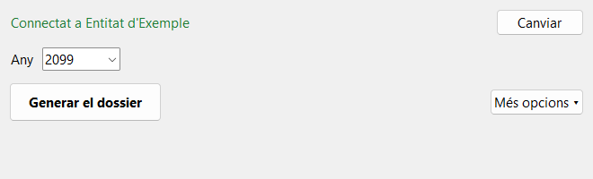

# Dossier de factures

[Versió en castellà](README.es.md)

Programa per a Windows que genera, des d'Odoo, el registre anual de factures de proveïdor (Excel) i un dossier PDF amb totes les factures. Està pensat per a associacions que han de justificar una subvenció, i per a persones que el faran servir una vegada a l'any.

**El programa només llegeix d'Odoo: no pot crear, canviar ni esborrar cap dada.**



## Què genera

Cada vegada crea una carpeta nova amb:

- **Un Excel** amb totes les factures i rebuts de l'any: número, proveïdor, NIF, base, IVA, total, pagaments, trimestre i pàgina del dossier. També hi surten les altres despeses de l'any (nòmines, comissions del banc…), en un apartat a part, perquè no tenen document.
- **Un PDF** amb portada, índex amb enllaços i cada factura en un full A4, amb una capçalera que resumeix les dades de la factura i el pagament. Les imatges es comprimeixen perquè el fitxer sigui manejable.

Si falta alguna cosa, per exemple un document o un NIF, el programa ho diu al final en una llista d'avisos.

## Què cal

- **Windows 10 o 11** de 64 bits.
- **Odoo 19**, amb accés a la seva API externa. A Odoo Online això **necessita el pla Custom**: amb els altres plans Odoo rebutja la connexió, i el programa ho explica amb un missatge.
- **Un usuari d'Odoo amb permís per llegir la comptabilitat**, i una clau d'API d'aquest usuari.

> De moment el programa només s'ha provat amb la clau d'un usuari administrador. El permís mínim, "Comptabilitat / Només lectura", encara no s'ha comprovat. Recomanem fer servir un usuari només de lectura. Si el seu permís no és suficient, el programa ho dirà amb un missatge.

## Com crear la clau d'API

1. A Odoo, feu clic al vostre nom (a dalt a la dreta) i obriu les preferències.
2. A la pestanya **Seguretat**, feu clic a **Add API Key**.
3. Escriviu una descripció, per exemple `Dossier de factures`, i trieu la durada. Odoo us pot demanar la contrasenya.
4. Copieu la clau que apareix. **Odoo només la mostra aquesta vegada.**

**Durada:** com que el programa es fa servir una vegada a l'any, trieu **1 Year** si Odoo ho permet. Cada grup d'usuaris té un límit (camp *API Keys maximum duration days* del grup): el rol de membre pot estar limitat a 90 dies, i aleshores caldrà crear una clau nova cada any, o que un administrador augmenti el límit. Quan una clau caduca, el programa ho diu i demana la nova.

Els noms dels botons depenen de l'idioma d'Odoo, i alguns surten en anglès.

## Com instal·lar-lo

No cal instal·lar res.

1. Aneu a [Releases](https://github.com/clamarobcn/odoo-dossier-factures/releases) i baixeu **DossierFactures.exe**.
2. Deseu-lo on vulgueu, per exemple a l'Escriptori, i obriu-lo amb un doble clic. La primera vegada pot trigar uns segons.

### L'avís de Windows

El programa no està signat digitalment, perquè la signatura té un cost anual. Per això Windows pot mostrar un avís de **SmartScreen**. Per continuar:

1. Feu clic a **Més informació** (*Más información*, si el Windows és en castellà).
2. Feu clic a **Executa igualment** (*Ejecutar de todas formas*).

Normalment només cal la primera vegada. El codi és públic en aquest repositori, i l'`.exe` el compila GitHub Actions a partir d'aquest codi.

## Com es fa servir

La [guia d'usuari](docs/guia-usuari.md) ho explica pas a pas. En resum:

1. La primera vegada, escriviu l'adreça d'Odoo i la clau, i feu clic a **Connectar**.
2. Trieu l'any i feu clic a **Generar el dossier**.
3. Feu clic a **Obrir la carpeta**.

El programa recorda l'adreça, la clau i les opcions. A **Més opcions** podeu filtrar per projecte o proveïdor, fer un PDF per trimestre, deixar fora els rebuts o les altres despeses, mostrar els noms a les despeses de personal i canviar la carpeta. Si un filtre fa que el dossier no sigui complet, el programa ho avisa al costat del botó.

## Seguretat i privadesa

- **Només lectura.** El client de l'API rebutja qualsevol mètode que no sigui de lectura, i hi ha proves automàtiques que ho comproven.
- **La clau** es desa a l'Administrador de credencials de Windows, mai en un fitxer.
- **Les dades** només viatgen entre el vostre ordinador i el vostre Odoo. Els documents baixats s'esborren en tancar el programa; només queden els fitxers generats a la carpeta que trieu.
- **Els fitxers generats contenen dades de proveïdors i, a l'Excel, despeses de personal.** Els noms dels treballadors no hi surten si no marqueu l'opció corresponent.
- La configuració i un registre tècnic, sense la clau, són a `%APPDATA%\DossierFactures`.

## Altres entitats i servidors

El programa no té res fixat a cap entitat. Si un mateix servidor té diverses bases de dades, indiqueu la que voleu a l'adreça: `https://servidor.example.com/?db=nom`.

## Per a desenvolupadors

Cal Python 3.12.

```bash
pip install -e ".[dev]"
```

```bash
pytest
```

```bash
ruff check src tests packaging
```

La mateixa funcionalitat és disponible per a proves i automatitzacions a `dossier-factures-cli.exe`, o a `dossier-factures` des del codi. La clau es llegeix de la variable d'entorn `ODOO_API_KEY` o del magatzem de credencials:

```bash
dossier-factures --url https://entitat.odoo.com generate --year 2026 --out sortida
```

Les proves fan servir dades inventades: el repositori no conté dades de cap entitat. Els textos són a `src/dossier_factures/i18n/ca.json`, i per afegir un idioma n'hi ha prou amb un altre fitxer com aquest.

Per publicar una versió, canvieu `__version__` i creeu l'etiqueta `v<versió>`: GitHub Actions passa les proves, compila els programes, els prova contra un Odoo simulat i els adjunta a la Release.

## Llicència

[MIT](LICENSE). Els components de tercers i les seves llicències es llisten a `THIRD_PARTY_LICENSES.txt`, a cada Release.
