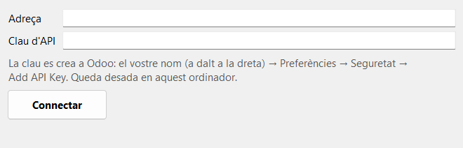
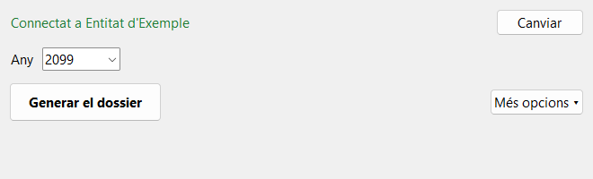
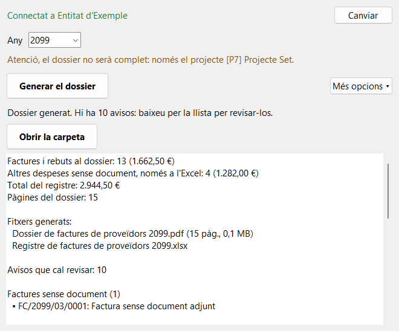
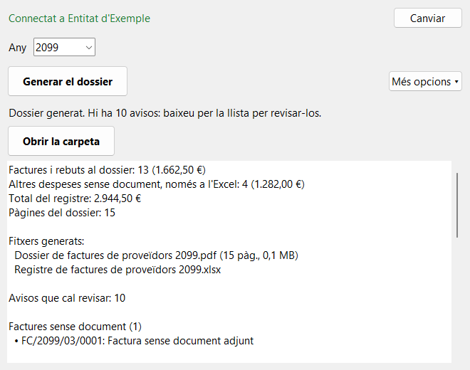

# Guia d'usuari

Aquesta guia explica com preparar el dossier de factures de l'any. Es fa una vegada a l'any i triga pocs minuts.

El programa **només llegeix** d'Odoo. Podeu provar-lo amb tranquil·litat: no pot canviar ni esborrar res.

## Abans de començar

Necessiteu:

- L'**adreça d'Odoo** de l'associació, la mateixa que feu servir al navegador. Per exemple: `entitat.odoo.com`.
- Una **clau d'API**. Si no en teniu, més avall s'explica com crear-la.
- Connexió a Internet.

Abans de generar el dossier, comproveu que **totes les factures de l'any estan introduïdes a Odoo**, amb el seu document adjunt.

## 1. Baixar el programa

Només cal fer-ho la primera vegada.

1. Obriu [la pàgina de versions](https://github.com/clamarobcn/odoo-dossier-factures/releases).
2. A la versió més recent, feu clic a **DossierFactures.exe**. No cal baixar els altres fitxers.
3. Moveu el fitxer a l'Escriptori, perquè el trobeu fàcilment.

> *[Espai per a una captura: pàgina de versions amb DossierFactures.exe assenyalat]*

## 2. Obrir el programa

Feu doble clic a **DossierFactures**. Apareix una imatge que diu "S'està obrint, un moment…". Pot trigar uns segons: **no torneu a fer doble clic**.

### Si Windows mostra un avís

La primera vegada pot aparèixer un avís blau de Windows. És normal, perquè el programa no té signatura digital.

1. Feu clic a **Més informació** (si el Windows és en castellà, *Más información*).
2. Feu clic a **Executa igualment** (*Ejecutar de todas formas*).

> *[Espai per a una captura: avís de SmartScreen amb "Més informació"]*

> *[Espai per a una captura: avís de SmartScreen amb "Executa igualment"]*

## 3. Connectar amb Odoo

Només cal fer-ho la primera vegada, o quan la clau caduca. Després el programa ho recorda i es connecta sol: passeu directament al pas 4.

1. A **Adreça**, escriviu l'adreça d'Odoo.
2. A **Clau d'API**, enganxeu la clau: feu clic amb el botó dret i trieu **Enganxa**. Es veuran punts en lloc de les lletres, i és normal.
3. Feu clic a **Connectar**.

### Com crear la clau d'API

Si no teniu clau, o el programa diu que ha caducat:

1. Entreu a Odoo amb el navegador.
2. Feu clic al vostre nom, a dalt a la dreta, i obriu les preferències.

   > *[Espai per a una captura: menú d'usuari d'Odoo]*

3. Obriu la pestanya **Seguridad** i feu clic a **Add API Key**.

   > *[Espai per a una captura: pestanya Seguridad amb Add API Key]*

4. Odoo pot demanar-vos la contrasenya. Escriviu-la.
5. A **Descripción**, escriviu `Dossier de factures`.
6. A **Duración**, trieu **1 Year**. Si no us ho deixa, trieu la durada més llarga que us permeti.

   > *[Espai per a una captura: finestra de la nova clau]*

7. Copieu la clau que apareix i enganxeu-la al programa. **Odoo només la mostra aquesta vegada.** Si la perdeu, no passa res: creeu-ne una altra.

Els textos d'aquestes pantalles són d'Odoo i poden canviar segons l'idioma.

## 4. Generar el dossier

1. Comproveu l'**Any**. El programa proposa l'any que s'acaba de tancar.
2. Feu clic a **Generar el dossier**.
3. Espereu. Veureu el progrés a la barra, i pot trigar uns minuts si hi ha moltes factures. Podeu parar amb **Cancel·lar**: no quedarà cap fitxer a mitges.

Si surt un text marró que comença per "**Atenció, el dossier no serà complet**", és que hi ha un filtre posat a **Més opcions**. Si voleu el dossier complet, obriu **Més opcions** i deixeu **Projecte** i **Proveïdor** a **(Tots)**.

## 5. Revisar el resultat

Quan acaba, el programa mostra un resum: nombre de factures, totals i pàgines.

**Baixeu per la llista i llegiu els avisos.** Indiquen coses que cal mirar a Odoo:

| Avís | Què vol dir | Què cal fer |
|---|---|---|
| Factura sense document | La factura no té cap document adjunt | Adjunteu-lo a Odoo i torneu a generar |
| Proveïdor sense NIF | La fitxa del proveïdor no té NIF | Completeu la fitxa a Odoo |
| Pagament sense conciliar | Hi ha un pagament que no està lligat amb la factura | Consulteu-ho amb qui porta la comptabilitat |
| Possible duplicat | Dos assentaments semblants del mateix mes | Comproveu que no sigui el mateix dues vegades |

Un avís no impedeix generar el dossier, però pot ser que l'Ajuntament us demani el que falta. Després de corregir alguna cosa a Odoo, torneu a fer clic a **Generar el dossier**: es crea una carpeta nova i no se sobreescriu res.

Feu clic a **Obrir la carpeta** per veure els dos fitxers:

- **Registre de factures de proveïdors** (Excel): la llista de totes les factures i despeses.
- **Dossier de factures de proveïdors** (PDF): totes les factures, amb índex.

Obriu el PDF i l'Excel i feu-hi una ullada abans d'enviar-los.

## Més opcions

Normalment no calen. Feu clic a **Més opcions** per veure-les:

| Opció | Què fa |
|---|---|
| Projecte | Només les factures d'un projecte |
| Proveïdor | Només les factures d'un proveïdor |
| Un PDF per trimestre | Fa un PDF per cada trimestre en lloc d'un de sol, si el fitxer és massa gran per enviar-lo |
| Inclou els rebuts de compra | Normalment marcat |
| Inclou a l'Excel les altres despeses | Nòmines, comissions del banc… Normalment marcat |
| Mostra els noms a les despeses de personal | Normalment **sense marcar**, per privadesa |
| Carpeta de sortida | On es desen els fitxers. Per defecte, Documents |

El programa recorda aquestes opcions per a la vegada següent. Només el filtre de proveïdor es perd en tancar.

## Si alguna cosa no funciona

| Missatge o problema | Què cal fer |
|---|---|
| "Odoo no accepta la clau d'API" | La clau ha caducat o és incorrecta. Creeu-ne una de nova (pas 3) |
| Missatge sobre el pla d'Odoo o els permisos | Consulteu-ho amb qui administra Odoo: cal el pla Custom i permís de lectura a la comptabilitat |
| "No hi ha cap factura…" | Comproveu l'any i els filtres de **Més opcions** |
| Problema de connexió | Comproveu que hi ha Internet i que l'adreça és la correcta |
| El programa no s'obre | Espereu mig minut. Si no s'obre, comproveu que l'antivirus no l'ha bloquejat |

Per canviar l'adreça o la clau, feu clic a **Canviar**, a dalt a la dreta.

Si cal demanar ajuda, el fitxer `dossier.log`, a la carpeta `%APPDATA%\DossierFactures`, conté informació tècnica i no conté la clau.
